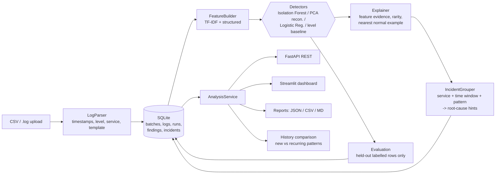

# AI-Powered Log Intelligence and Explainable Root-Cause Assistance Platform

Detect anomalous application logs, explain each alert, group related alerts into incidents and suggest where to look
first. Inspired by the IEEE paper *"Anomaly Detection in Logs Using Deep Learning"*
([IEEE Xplore 10767232](https://ieeexplore.ieee.org/document/10767232/)) - **not a reimplementation**, and **no claim
of outperforming it**. See [docs/RESEARCH_COMPARISON.md](docs/RESEARCH_COMPARISON.md).

## Status at a glance
| | |
|---|---|
| Core library (parse, features, detectors, explain, incidents, SQLite, reports) | Implemented, tested, run |
| Experiment script | Implemented, run (synthetic data only) |
| FastAPI REST API | Implemented, **compiled but NOT executed or tested** in the build sandbox (package not installable offline) |
| Streamlit dashboard | Implemented, **compiled but NOT executed** (same reason) |
| Paper methodology verification | **Partial** - full text could not be accessed |
| Real-dataset evaluation | **Not done** |

## Architecture

Code map: `logintel/{parsing,features,detectors,pipeline,evaluation,explain,incidents,storage,service,reporting,api,synthetic}.py`.

## Quick start
```bash
python -m venv .venv && source .venv/bin/activate
pip install -r requirements.txt
python data/generate_sample_data.py                      # regenerates safe synthetic samples
python -m unittest discover -s tests -v                  # or: pytest
python experiments/run_experiment.py                     # reproducible comparison -> results/
uvicorn logintel.api:app --reload                        # REST API  (docs at /docs)
streamlit run dashboard/app.py                           # dashboard (same SQLite DB)
```
`LOGINTEL_DB` sets the database path (default `data/logintel.db`; share it between API and dashboard).
Other env vars: `LOGINTEL_MAX_UPLOAD_BYTES`, `LOGINTEL_MAX_ROWS`, `LOGINTEL_LOG_LEVEL`.

## Input formats
* **CSV** - needs a message column (`message|msg|log|text|event|content|body`); optional timestamp, level, service and
  `label` (0/1) columns under common aliases. Labels enable evaluation.
* **Plain text** - `2024-03-01 08:00:00,123 ERROR [payment] message`; `service=name` inside the message is also recognised;
  indented/`Traceback`/`at ...` lines are appended to the previous record; malformed lines are counted and skipped.

## Methods
* **Features:** TF-IDF on masked templates (numbers, IPs, UUIDs, hex, ids replaced) + level, message shape, template rarity
  against the training reference, per-service events/errors per minute, service one-hots.
* **Detectors (same data, same protocol):** `isolation_forest`, `pca_reconstruction` (linear-autoencoder analogue),
  `logistic_regression` (supervised), `level_baseline`.
* **Evaluation:** chronological split (first 60% fit, rest scored for metrics) or a separate reference batch. Held-out
  rows only; metrics are `null` when ground truth is absent or single-class.
* **Explanations:** PCA = exact per-feature error decomposition; logistic = exact coefficient x value terms;
  Isolation Forest = z-score heuristic. All findings also show template frequency in the reference data and the nearest
  normal log line.
* **Incidents:** anomalies -> per-service episodes (gap, default 120 s, min 3 events) -> cross-service groups. Earliest
  episode is the *candidate origin*; keyword rules give a category hint. These are heuristics, not causal proof.
* **History:** each run is stored; `/runs/{id}/history` compares anomaly rate and new/recurring anomalous patterns and
  incident signatures with earlier runs of the same detector.

## Experiment results (synthetic data - reproduce with `python experiments/run_experiment.py`)
5 seeds, 60/40 chronological split, contamination 0.05, mean +/- std. Test half includes a failure type (`disk_full`) absent from training.

| Detector | precision | recall | F1 | ROC-AUC | PR-AUC | novel-scenario recall |
|---|---|---|---|---|---|---|
| level_baseline | 0.702 +/- 0.017 | 0.593 +/- 0.000 | 0.643 +/- 0.007 | 0.787 +/- 0.001 | 0.443 +/- 0.010 | 0.812 +/- 0.000 |
| isolation_forest | 0.356 +/- 0.044 | 0.343 +/- 0.047 | 0.348 +/- 0.043 | 0.797 +/- 0.011 | 0.253 +/- 0.020 | 0.244 +/- 0.122 |
| isolation_forest (normal-only) | 0.000 +/- 0.000 | 0.000 +/- 0.000 | 0.000 +/- 0.000 | 0.248 +/- 0.029 | 0.043 +/- 0.002 | 0.000 +/- 0.000 |
| pca_reconstruction | 0.561 +/- 0.049 | 0.629 +/- 0.000 | 0.592 +/- 0.027 | 0.972 +/- 0.004 | 0.704 +/- 0.027 | 1.000 +/- 0.000 |
| pca_reconstruction (normal-only) | 0.568 +/- 0.038 | 1.000 +/- 0.000 | 0.723 +/- 0.031 | 0.998 +/- 0.001 | 0.959 +/- 0.019 | 1.000 +/- 0.000 |
| logistic_regression | 0.951 +/- 0.013 | 0.996 +/- 0.007 | 0.973 +/- 0.009 | 1.000 +/- 0.000 | 0.999 +/- 0.002 | 0.994 +/- 0.013 |

How to read this: the data are synthetic and cleanly separable, so absolute numbers say nothing about real systems and
**nothing about the base paper**. What the run does show: (1) the naive level filter is a strong baseline here - on its
own F1 (0.64) it beats Isolation Forest and, at its default threshold, ranks above PCA on F1 when PCA is fit on contaminated data;
(2) PCA reconstruction ranks anomalies far better (ROC-AUC 0.97-1.00) than Isolation Forest on these features;
(3) Isolation Forest trained on normal-only data scored below chance - likely because text features that are constant in
normal data give it nothing to split on (hypothesis, not verified); (4) supervised success is expected given the
shared templates between train and test.

## API examples
```bash
curl -F "file=@data/sample_batch_1.csv" -F "name=batch1" http://localhost:8000/batches
curl -X POST http://localhost:8000/batches/1/analyze -H 'Content-Type: application/json' \
     -d '{"detector":"pca_reconstruction","contamination":0.05}'
curl -X POST http://localhost:8000/batches/2/analyze -H 'Content-Type: application/json' \
     -d '{"detector":"logistic_regression","train_batch_id":1}'          # fit on an earlier batch
curl -X POST http://localhost:8000/batches/1/compare -H 'Content-Type: application/json' -d '{}'
curl "http://localhost:8000/runs/1/findings?service=db&min_score=0.9&limit=20"
curl http://localhost:8000/runs/1/incidents
curl http://localhost:8000/runs/2/history
curl -OJ "http://localhost:8000/runs/1/report?format=md"                 # json | csv | md
```
Endpoints: `GET /health`, `POST/GET /batches`, `GET /batches/{id}`, `POST /batches/{id}/analyze`,
`POST /batches/{id}/compare`, `GET /runs`, `GET /runs/{id}`, `GET /runs/{id}/{findings|incidents|history|report}`.
Errors: 400 invalid input, 404 unknown id, 413 oversize upload, 422 analysis cannot run (e.g. supervised without labels).

## Testing
`python -m unittest discover -s tests -v` -> 39 tests (2 API tests skip automatically without fastapi/httpx). Covers
parsing, templates, features, detectors (incl. exact PCA decomposition check), metrics, incident grouping, storage,
end-to-end service flow (repeat uploads, history, reference-batch training, failure paths, reports).

## Safety / privacy
All bundled data is synthetic. Uploaded logs are stored unredacted in local SQLite; the API has no authentication.
Do not expose it publicly or upload sensitive logs without adding access control and PII masking.

## Remaining limitations
See [docs/RESEARCH_COMPARISON.md](docs/RESEARCH_COMPARISON.md) section 4. Highlights: paper not fully verified; synthetic-only
evaluation; line-level (not sequence) detection; heuristic root-cause ranking (sometimes picks a downstream service first);
API/dashboard untested in the build environment.
